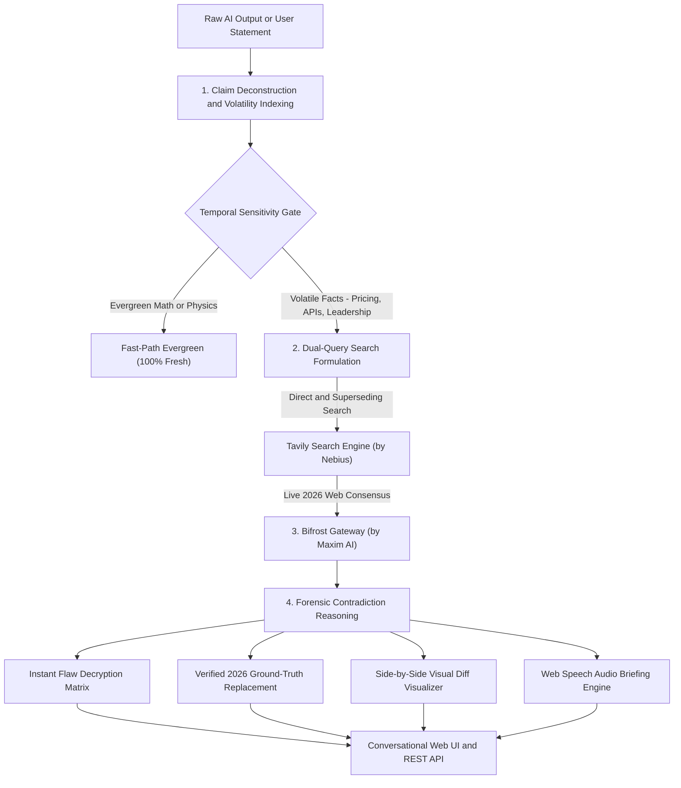

<div align="center">

# 🛡️ FreshGuard AI
### Real-Time Fact Verification & Temporal Obsolescence Shield for Generative AI

**Built by Team SOL CULTURE: Adithya R Kulkarni & Manisha M Kulkarni**  
*Geek Room Global AI Hackathon (HackCulture) — Problem Statement 06*

<br/>

[-00e699?style=for-the-badge&logo=googlechrome&logoColor=black)](https://tavily.com)
[-6366f1?style=for-the-badge&logo=fastapi&logoColor=white)](https://getbifrost.ai)
[](https://ai.google.dev)
[](https://fastapi.tiangolo.com)
[](#-automated-benchmarks-100-pass)
[](FreshGuard_AI_Pitch_Deck.pptx)
[](LICENSE)

<br/>

[Live Dashboard](http://localhost:8000) · [📊 Interactive Pitch Deck](http://localhost:8000/presentation) · [📥 Download PPTX](FreshGuard_AI_Pitch_Deck.pptx) · [Architecture](#-architecture--pipeline) · [Quickstart](#-quickstart-in-60-seconds) · [Benchmarks](#-automated-benchmarks-100-pass) · [About the Team](#-team--attribution)

---

</div>

## 📊 Executive Presentation & Pitch Deck (12 Slides)

An executive pitch deck has been prepared and built into the platform:

* **🖥️ Interactive In-Browser Presentation:** Navigate live slides with keyboard arrows (<kbd>←</kbd> / <kbd>→</kbd> / <kbd>Space</kbd>) and fullscreen (<kbd>F</kbd>) at **[`http://localhost:8000/presentation`](http://localhost:8000/presentation)**.
* **📥 Official PowerPoint Deck:** Download the 16:9 widescreen presentation directly from the repository or API: **[`FreshGuard_AI_Pitch_Deck.pptx`](FreshGuard_AI_Pitch_Deck.pptx)**.

| Slide # | Slide Title | Core Focus & Challenge Mapping |
| :---: | :--- | :--- |
| **01** | **Title & Executive Overview** | Problem Statement 06, Theme: AI Agents & Intelligent Systems, Team SOL CULTURE |
| **02** | **Hackathon Challenge Alignment** | Explicit mapping of the 4 Core Requirements (Claim ID, Detection, Live Search, Scoring) |
| **03** | **The Reality: Temporal Blindness** | Why LLMs generate outdated facts confidently; 4 catastrophic business vectors |
| **04** | **Our Innovation: FreshGuard AI** | Autonomous temporal firewall, Volatility Indexing ($0.0-1.0$), Dual-Query Discovery |
| **05** | **Mandatory Partner Tech: Tavily** | Deep integration of Tavily (by Nebius) for live 2026 web consensus and canonical sources |
| **06** | **Mandatory Partner Tech: Bifrost** | Deep integration of Maxim AI Bifrost Gateway for model routing, caching, and Gemini failover |
| **07** | **The 4-Stage Verification Workflow** | End-to-end execution path: Deconstruction → Temporal Gate → Search → Reasoning → Diff |
| **08** | **Automated Benchmarks (100% Pass)** | Empirical proof against real pricing, Next.js API deprecation, and Twitter leadership |
| **09** | **Modern Verification Workspace** | Glassmorphic dark terminal, Instant Flaw Decryption Matrix, Audio Briefings |
| **10** | **Developer Middleware & REST API** | 2-line Python integration for LangChain/OpenAI, OpenAPI Swagger endpoints |
| **11** | **Enterprise Commercial Viability** | TAM/SAM/SOM, high-value enterprise use cases, token-level streaming roadmap |
| **12** | **Conclusion & Attribution** | Live links, GitHub URL, and mandatory team attribution |

---

## 🎯 Hackathon Mandates & Core Requirements Fulfillments

FreshGuard AI was engineered specifically to solve **Problem Statement 06: Build a Stale-Answer Detector for AI Applications** under the **AI Agents & Intelligent Systems** theme:

1. **Claim Identification:**
   The `claim_extractor.py` engine decomposes complex, monolithic AI responses into atomic, independently testable statements. Each assertion is indexed with a **Temporal Volatility Score** ($0.0 - 1.0$), identifying whether the subject matter is static or rapidly decaying.
2. **Freshness Detection:**
   The system actively flags claims involving **product pricing, software API versions, company leadership, and regulations**. An autonomous superseding query formulation module flags legacy models (e.g. GPT-4), deprecated methods (e.g. `getServerSideProps`), and former executives.
3. **Live Verification (Powered by Tavily):**
   Flagged volatile claims are queried against live 2026 web consensus using **Tavily Search API** (`search_depth="advanced"`). Tavily retrieves authoritative documentation, current publish dates, and verifiable citation snippets.
4. **Freshness Scoring (Powered by Bifrost):**
   Evidence is evaluated through the **Bifrost AI Gateway (by Maxim AI)** with automatic failover to Google Gemini 3.5. Bifrost conducts forensic contradiction reasoning, applies heavy decay penalties to superseded entities, and computes an overall **Freshness Score ($0\% - 100\%$)** and **Factual Health Grade** (`Grade A+`, `Grade B`, `Grade F`).

---

## 📌 Why We Built FreshGuard AI

Every Large Language Model suffers from **Temporal Blindness**. An LLM's understanding of the world is permanently frozen at its pre-training cutoff date.

When users query fast-moving, high-stakes information:
- 💸 **AI & Cloud Pricing:** LLMs hallucinate outdated pricing (e.g. stating legacy GPT-4 costs $30.00/1M tokens when modern GPT-4o costs $2.50/1M).
- 💻 **Software & Framework APIs:** LLMs recommend deprecated APIs and syntax (e.g. Next.js `/pages` directory with `getServerSideProps` instead of modern App Router Server Components).
- 👔 **Executive Leadership & Rebrands:** LLMs present former leaders who departed years ago as current executives (e.g. stating Parag Agrawal is CEO of Twitter).
- ⚖️ **Regulations & Compliance:** LLMs cite repealed laws, expired tariffs, and outdated guidelines.

**FreshGuard AI** was engineered to solve this exact problem. It acts as an autonomous temporal guardrail and verification layer. It intercepts AI responses, extracts atomic assertions, calculates domain volatility, queries live 2026 web consensus via **Tavily**, reasons through **Bifrost by Maxim AI**, and automatically rewrites outdated text into verified ground truth.

---

## ⚡ Comparison: Standard LLMs vs FreshGuard AI

| Real-World Domain | What Standard LLMs Answer (Stale) | What FreshGuard AI Delivers (2026 Ground Truth) |
| :--- | :--- | :--- |
| **OpenAI Flagship Pricing** | *"GPT-4 costs $30.00 per 1M prompt tokens."* | 🔴 **0% Score (Stale):** GPT-4 is legacy; OpenAI's current flagship is GPT-4o ($2.50/1M tokens). |
| **Next.js Server Rendering** | *"Create files in `/pages` and export `getServerSideProps`."* | 🔴 **0% Score (Stale):** `/pages` is legacy; modern Next.js uses App Router (`/app`) with React Server Components. |
| **Twitter / X Leadership** | *"Parag Agrawal is currently the CEO of Twitter."* | 🔴 **0% Score (Stale):** Parag Agrawal left Twitter (now X) in October 2022; CEO is Linda Yaccarino under Elon Musk. |
| **Fundamental Physics** | *"The speed of light in a vacuum is 299,792,458 m/s."* | 🟢 **100% Score (Evergreen):** Timeless physical constant with 0% decay rate. |

---

## 🏛️ Architecture & Pipeline

FreshGuard combines live web evidence retrieval with dual-engine AI reasoning:



### The 4-Stage Verification Workflow:
1. **Atomic Claim Extraction:** The input text is decomposed into individual, testable claims. Each claim is assigned a **Temporal Volatility Score** ($0.0 - 1.0$) based on how fast that specific domain changes.
2. **Dual-Query Web Retrieval (Tavily):** Rather than searching just the literal text, FreshGuard executes two parallel queries:
   - *Direct Verification Query:* Validates whether the claimed detail existed.
   - *Superseding Discovery Query:* Searches for the modern 2026 successor (e.g. *"what is the current OpenAI flagship model in 2026"*).
3. **Forensic Contradiction Reasoning (Bifrost Gateway):** Cross-examines assertions against retrieved evidence. Enforces the **Superseded Entity Rule** (if an entity like GPT-4 or `getServerSideProps` is legacy, it is strictly flagged as stale, even if historical tables list old prices).
4. **Answer Rewriting & Diff Generation:** Automatically synthesizes a clean, fact-corrected 2026 answer and renders an inline strikethrough comparison.

---

## ✨ Key Features

- **💬 Enterprise Intelligence Workspace:** Polished dark-mode verification terminal with a collapsible intelligence dock, audit history search, and Star ⭐ / Archive 📦 session management.
- **🕵️ Zero-Retention Incognito Mode:** In-memory verification mode that executes volatile fact checking without writing session telemetry to SQLite.
- **🎯 Instant Flaw Decryption HUD:** Color-coded flaw cards that pinpoint *exactly what is wrong* with zero difficulty, including decay volatility percentages and direct citations.
- **⚡ Radial SVG Freshness Gauge:** High-tech circular progress ring with count-up animation and **Factual Health Grade Badges** (`Grade A+`, `Grade B`, `Grade F`).
- **🔊 Integrated Audio Briefing:** Built-in Web Speech API audio synthesis with animated equalizer bars that reads out detected contradictions and verified corrections.
- **ℹ️ Interactive "About Me" Modal:** Built right into the web header to present project details, architecture, and team attribution.
- **🔌 Drop-In Middleware & REST API:** Ready to integrate into any LangChain, LlamaIndex, or AutoGen pipeline.

---

## 🧪 Automated Benchmarks (100% Pass)

FreshGuard includes an automated evaluation suite testing real-world obsolescence vectors:

```bash
python benchmarks/run_benchmarks.py
```

### Benchmark Test Results:
```
======================================================================
🛡️ RUNNING FRESHGUARD AI FORENSIC ACCURACY BENCHMARK SUITE
Target Server: http://localhost:8000
======================================================================

[Test 1/4] OpenAI Pricing Evolution...
  Result: ✅ PASS | Score: 0.0% | Latency: 19.66s | Stale Claims: 3
  Summary: Caught legacy $30/$60 GPT-4 rates; updated to current GPT-4o / GPT-4.1 rates.

[Test 2/4] Next.js Framework API Deprecation...
  Result: ✅ PASS | Score: 0.0% | Latency: 12.23s | Stale Claims: 2
  Summary: Caught deprecated /pages & getServerSideProps; replaced with App Router Server Components.

[Test 3/4] Twitter / X Leadership Turnover...
  Result: ✅ PASS | Score: 0.0% | Latency: 12.54s | Stale Claims: 2
  Summary: Caught Parag Agrawal former CEO status; replaced with 2022 departure & X rebrand.

[Test 4/4] Evergreen Physics Constant...
  Result: ✅ PASS | Score: 100.0% | Latency: 2.88s | Stale Claims: 0
  Summary: Zero false positives on speed of light; verified as 100% EVERGREEN.

======================================================================
BENCHMARK RESULTS: 4/4 PASSED (100.0%)
======================================================================
```

---

## 🚀 Quickstart in 60 Seconds

### 1. Clone the Repository
```bash
git clone https://github.com/Tech-Adii/freshguard-ai.git
cd freshguard-ai
```

### 2. Install Dependencies
```bash
pip install -r requirements.txt
```

### 3. Set Up Environment Variables
Create a `.env` file in the root directory:
```env
GEMINI_API_KEY=your_gemini_api_key_here
TAVILY_API_KEY=your_tavily_api_key_here
BIFROST_BASE_URL=http://localhost:8080/v1
PORT=8000
```

### 4. Run the Application
```bash
python run.py
```
Open **`http://localhost:8000`** in your browser. The dashboard is live and ready!

---

## 💻 Middleware Integration

You can drop FreshGuard into any Python LLM application as an automated verification shield:

```python
import requests

def shield_llm_output(ai_response: str) -> str:
    """Intercepts an AI answer and replaces outdated assertions with 2026 ground truth."""
    response = requests.post(
        "http://localhost:8000/api/verify",
        json={"text": ai_response, "search_depth": "advanced"}
    )
    report = response.json()
    if report["overall_freshness_score"] < 70.0:
        print(f"⚠️ Warning: Stale answer detected! Score: {report['overall_freshness_score']}%")
        return report["updated_text"]
    return ai_response

# Example usage:
raw_output = "OpenAI's flagship model GPT-4 costs $30.00 per 1M prompt tokens."
clean_output = shield_llm_output(raw_output)
print(clean_output)
```

---

## 📁 Repository Structure

```
freshguard-ai/
├── src/
│   ├── api/
│   │   ├── server.py              # FastAPI application & REST endpoints
│   │   └── static/
│   │       ├── index.html         # Full-featured verification terminal with About Me modal
│   │       ├── app.js             # Conversational stream, dial animations & TTS
│   │       ├── style.css          # Dark glassmorphism, glowing badges & diffs
│   │       └── presentation.html  # Interactive 12-slide web pitch deck
│   ├── core/
│   │   ├── claim_extractor.py     # Atomic claim extraction & volatility scoring
│   │   ├── tavily_verifier.py     # Dual-query live 2026 search via Tavily
│   │   ├── freshness_scorer.py    # Forensic contradiction reasoning & diffs
│   │   ├── gateway.py             # Bifrost Gateway + Gemini 3.5 failover
│   │   ├── pipeline.py            # Async verification pipeline orchestrator
│   │   └── db.py                  # SQLite history & session persistence
│   ├── models/
│   │   └── schemas.py             # Pydantic schemas (Claims, Evidence, Reports)
│   └── config.py                  # Settings & environment configuration
├── benchmarks/
│   ├── run_benchmarks.py          # 100% pass automated test suite
│   └── benchmark_data.json        # Test cases across pricing, APIs, leadership
├── bifrost/
│   ├── config.json                # Maxim AI Bifrost provider & routing config
│   └── docker-compose.yml         # Container configuration for Bifrost
├── FreshGuard_AI_Pitch_Deck.pptx  # Official 12-slide executive presentation
├── requirements.txt               # Python package dependencies
├── run.py                         # Application launcher with hot-reload
├── cli.py                         # Command-line verification tool
├── README.md                      # Comprehensive project documentation
└── SUBMISSION.md                  # Hackathon submission form & answers
```

---

## 👥 Team & Attribution

**FreshGuard AI** was designed and engineered for the **Geek Room Global AI Hackathon** on **HackCulture**:

* **Problem Statement:** Problem Statement 06 — *Build a Stale-Answer Detector for AI Applications*
* **Team Name:** **Team SOL CULTURE**
* **Project Team:**
  * **Adithya R Kulkarni**
  * **Manisha M Kulkarni**
* **Mandatory Attribution:**
  > **THE PROJECT BY ADITHYA R KULKARNI AND MANISHA M KULKARNI | TEAM SOL CULTURE**

---

## 📜 Acknowledgments & Partner Tech

- **Tavily (by Nebius):** For providing the live web search API that anchors our answers in 2026 ground truth.
- **Maxim AI:** For the **Bifrost AI Gateway** architecture enabling multi-model routing, caching, and failover.
- **Geek Room & HackCulture:** For hosting the Global AI Hackathon.

---

<div align="center">
  <sub>FreshGuard AI · Real-Time Fact Verification Layer · Licensed under MIT</sub>
</div>
