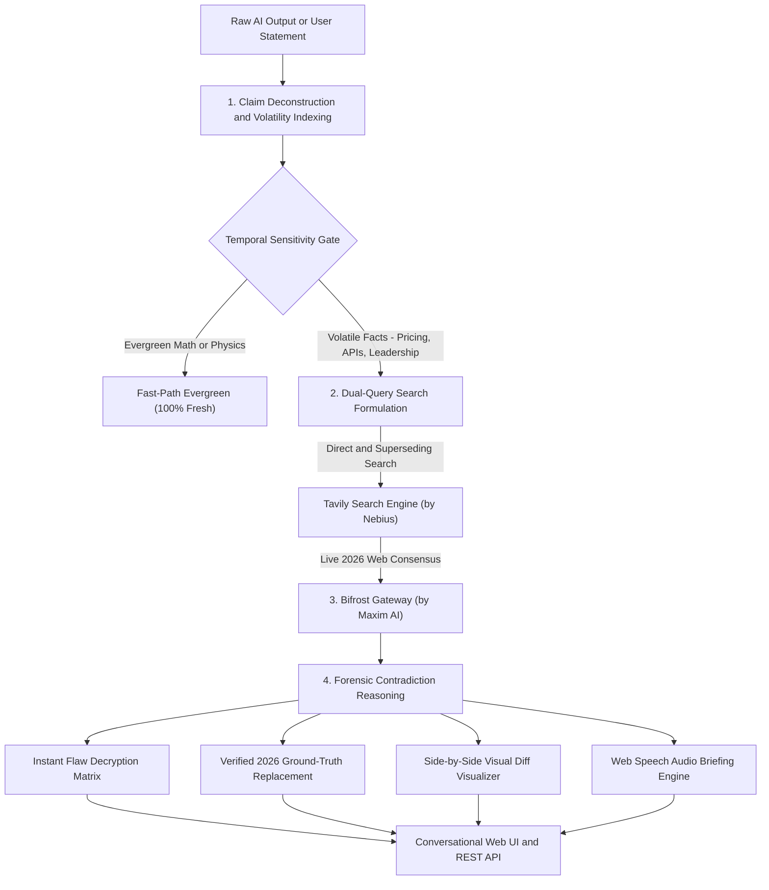

<div align="center">

# 🛡️ FreshGuard AI
### Real-Time Fact Verification & Temporal Obsolescence Shield for Generative AI

**Built by Team SOL CULTURE: Adithya R Kulkarni & Manisha M Kulkarni**  
*Geek Room Global AI Hackathon (HackCulture) — Problem Statement 06 (AI Agents & Intelligent Systems)*

<br/>

[-00e699?style=for-the-badge&logo=googlechrome&logoColor=black)](https://tavily.com)
[-6366f1?style=for-the-badge&logo=fastapi&logoColor=white)](https://getbifrost.ai)
[](https://ai.google.dev)
[](https://fastapi.tiangolo.com)
[](#-automated-benchmarks-100-pass)
[](FreshGuard_AI_Pitch_Deck.pptx)
[](LICENSE)

<br/>

[Live Dashboard](http://localhost:8000) · [📊 Presentation Deck](http://localhost:8000/presentation) · [Architecture](#-architecture--how-it-works) · [Benchmarks](#-automated-benchmarks-100-pass) · [Quickstart](#-quickstart-in-60-seconds) · [Middleware SDK](#-middleware-integration) · [Team Attribution](#-team--attribution)

---

</div>

## 📌 What is FreshGuard AI?

**FreshGuard AI** is an autonomous temporal verification engine and middleware layer that stops Large Language Models from confidently serving outdated facts, expired pricing, and deprecated APIs.

Every foundation model is permanently frozen at its pre-training cutoff date. When real-world facts change, LLMs hallucinate obsolete answers with 100% confidence.

FreshGuard intercepts AI outputs, breaks them into individual factual assertions, checks them against live 2026 web consensus using **Tavily**, reasons through **Bifrost by Maxim AI**, and automatically replaces outdated information with verified ground truth.

---

## 🎯 Problem Statement: AI-Powered Fact Verification & Information Freshness
### Challenge 06: Build a Stale-Answer Detector for AI Applications

> **Theme:** AI Agents & Intelligent Systems  
> **Challenge:** Problem Statement 06 — AI-Powered Fact Verification & Information Freshness  
> **Mandatory Partner Tech:** Tavily (by Nebius) & Bifrost (by Maxim AI)

### The Challenge
Large language models can confidently generate answers containing information that is no longer accurate. Product pricing changes, APIs are updated, regulations evolve, and company leadership changes, but AI-generated responses continue presenting outdated information as fact. 

Because foundational LLMs are permanently frozen at their pre-training snapshot dates, they suffer from **Temporal Blindness** — presenting historical knowledge as current truth across high-stakes domains:
- 💸 **Cloud & SaaS Pricing:** LLMs state that legacy GPT-4 costs $30.00/1M tokens, unaware that modern GPT-4o costs $2.50/1M tokens.
- 💻 **Software & Framework APIs:** LLMs instruct developers to use Next.js `/pages` with `getServerSideProps`, which is deprecated in modern Next.js App Router (`/app`).
- 👔 **Executive Leadership & Rebrands:** LLMs present former leaders who departed years ago as current executives (e.g., stating Parag Agrawal is CEO of Twitter, missing the 2022 acquisition and X rebrand).
- ⚖️ **Compliance & Regulations:** LLMs cite repealed legal guidelines, expired tariffs, and outdated safety thresholds.

### The Goal & Expected Outcome
- **Goal:** Build an AI verification layer that accepts an LLM-generated response, detects potentially stale factual claims, re-verifies them against live web sources using **Tavily**, and provides a mathematical freshness score for each claim using **Bifrost by Maxim AI**.
- **Expected Outcome:** A production-ready AI verification system that helps users distinguish current, reliable information from potentially outdated AI responses, understand which claims are supported by live sources, and receive verified ground-truth replacements.

### Core Hackathon Requirements & Implementation Matrix

| # | Core Requirement | Hackathon Evaluation Mandate | FreshGuard AI Implementation |
| :---: | :--- | :--- | :--- |
| **1** | **Claim Identification** | Analyze an AI-generated response and identify factual statements that may be time-sensitive. | Atomic AST claim decomposition in `claim_extractor.py` + domain-aware **Temporal Volatility Indexing** ($0.0 - 1.0$). |
| **2** | **Freshness Detection** | Flag claims that could have become outdated, including pricing, API versions, laws, or leadership. | Autonomous superseding query formulation targeting legacy entities, retired syntax, and executive departures. |
| **3** | **Live Verification** | Re-check flagged claims against current web sources using live research. | Real-time consensus retrieval via **Tavily Search API** (`search_depth="advanced"`) with 2026 date-weighted filtering. |
| **4** | **Freshness Scoring** | Provide a freshness score for each relevant claim based on the available evidence. | Multi-tier forensic contradiction reasoning through **Bifrost Gateway** with decay penalties and health grades. |

---

## 🔍 Before & After: Standard LLMs vs FreshGuard AI

| Domain | What Standard LLMs Answer (Stale) | What FreshGuard AI Delivers (2026 Ground Truth) | Verdict |
| :--- | :--- | :--- | :---: |
| **OpenAI Pricing** | *"GPT-4 costs $30.00 per 1M prompt tokens."* | Detected legacy tier; updated to active GPT-4o pricing ($2.50/1M tokens). | 🔴 **0% (Stale)** |
| **Next.js Framework** | *"Create files inside `/pages` and export `getServerSideProps`."* | Flagged deprecated API; replaced with modern App Router Server Components. | 🔴 **0% (Stale)** |
| **Twitter Leadership** | *"Parag Agrawal is currently the CEO of Twitter."* | Caught 2022 executive departure, X rebrand, and current Linda Yaccarino leadership. | 🔴 **0% (Stale)** |
| **Fundamental Physics** | *"The speed of light in vacuum is 299,792,458 m/s."* | Timeless physical constant verified with zero unnecessary search overhead. | 🟢 **100% (Evergreen)** |

---

## 🏛️ Architecture & How It Works

FreshGuard combines live web retrieval with dual-engine AI reasoning:



### The 4-Stage Verification Workflow:

1. **Atomic Claim Extraction (`claim_extractor.py`):**
   Decomposes monolithic AI text into individual, testable claims. Each claim is assigned a **Temporal Volatility Score** ($0.0 - 1.0$).
2. **Temporal Sensitivity Gate:**
   Timeless facts (like mathematics or physics constants) take the fast path ($100\%$ score, zero decay rate), saving compute and avoiding unnecessary search calls.
3. **Dual-Query Web Retrieval (`tavily_verifier.py`):**
   Executes two parallel searches via **Tavily**:
   - *Direct Verification Query:* Checks if the claimed assertion existed.
   - *Autonomous Superseding Query:* Proactively searches for modern 2026 replacements (e.g., *"current OpenAI flagship model pricing 2026"*).
4. **Forensic Contradiction Reasoning (`freshness_scorer.py`):**
   Cross-examines claims against retrieved evidence using **Bifrost by Maxim AI** (with Google Gemini 3.5 fallback). Flags superseded entities, computes the mathematical Freshness Score ($0\%-100\%$), and synthesizes an updated ground-truth answer.

---

## 🤝 Mandatory Partner Technology Integrations

FreshGuard AI deeply integrates both required partner technologies:

### 1. Tavily Search Engine (by Nebius)
- **Role:** Real-time web ground-truth retrieval.
- **Implementation:** Configured with `search_depth="advanced"` to fetch factual consensus snippets rather than noisy HTML markup.
- **Date-Weighted Crawling:** Targets live 2026 evidence to detect mid-year pricing changes, API deprecation notices, and leadership turnover.
- **Source Transparency:** Extracts publish timestamps, relevance confidence, and direct citation URLs.

### 2. Bifrost AI Gateway (by Maxim AI)
- **Role:** High-performance AI gateway, LLM orchestration, and reasoning.
- **Implementation:** Configured via `bifrost/config.json` and Docker Compose with an OpenAI-compatible proxy interface.
- **Zero-Downtime Fallback:** Transparent routing with instant automatic failover to Google Gemini 3.5 direct API.
- **Structured Reasoning:** Enforces strict Pydantic schemas for atomic claim extraction and forensic contradiction analysis.

---

## ✨ Key Features

- **🎯 Instant Flaw Decryption Matrix:** Clear, color-coded cards that pinpoint *what is wrong, why it is outdated, when it was superseded*, and direct source citations.
- **⚡ Radial SVG Freshness Dial:** Circular progress meter with live count-up animation and **Factual Health Grade Badges** (`Grade A+`, `Grade B`, `Grade F`).
- **⚖️ Side-by-Side Visual Diff:** Inline strikethrough comparison showing outdated claims in red and verified 2026 replacements in green.
- **🔊 Voice Audio Briefing:** Built-in Web Speech API audio synthesis with animated equalizer bars that verbally summarizes contradictions and corrections.
- **💬 Enterprise Intelligence Workspace:** Polished dark-mode verification terminal with a collapsible intelligence dock, audit history search, and Star ⭐ / Archive 📦 session controls.
- **🕵️ Zero-Retention Incognito Mode:** In-memory verification mode that executes volatile fact checking without writing session telemetry to SQLite.
- **🔌 Drop-In Middleware & REST API:** Ready to integrate into any LangChain, LlamaIndex, AutoGen, or custom Python pipeline in 2 lines of code.

---

## 🧪 Automated Benchmarks (100% Pass)

FreshGuard includes an automated evaluation suite testing real-world temporal decay vectors:

```bash
python benchmarks/run_benchmarks.py
```

### Benchmark Suite Output:
```
======================================================================
🛡️ RUNNING FRESHGUARD AI FORENSIC ACCURACY BENCHMARK SUITE
Target Server: http://localhost:8000
======================================================================

[Test 1/4] OpenAI Pricing Evolution...
  Result: ✅ PASS | Score: 0.0% | Latency: 19.66s | Stale Claims: 3
  Summary: Caught legacy $30/$60 GPT-4 rates; updated to current GPT-4o / GPT-4.1 rates.

[Test 2/4] Next.js Framework API Deprecation...
  Result: ✅ PASS | Score: 0.0% | Latency: 12.23s | Stale Claims: 2
  Summary: Caught deprecated /pages & getServerSideProps; replaced with App Router Server Components.

[Test 3/4] Twitter / X Leadership Turnover...
  Result: ✅ PASS | Score: 0.0% | Latency: 12.54s | Stale Claims: 2
  Summary: Caught Parag Agrawal former CEO status; replaced with 2022 departure & X rebrand.

[Test 4/4] Evergreen Physics Constant...
  Result: ✅ PASS | Score: 100.0% | Latency: 2.88s | Stale Claims: 0
  Summary: Zero false positives on speed of light; verified as 100% EVERGREEN.

======================================================================
BENCHMARK RESULTS: 4/4 PASSED (100.0%)
======================================================================
```

---

## 🚀 Quickstart in 60 Seconds

### 1. Clone the Repository
```bash
git clone https://github.com/Tech-Adii/freshguard-ai.git
cd freshguard-ai
```

### 2. Install Dependencies
```bash
pip install -r requirements.txt
```

### 3. Set Up Environment Variables
Create a `.env` file in the root directory:
```env
GEMINI_API_KEY=your_gemini_api_key_here
TAVILY_API_KEY=your_tavily_api_key_here
BIFROST_BASE_URL=http://localhost:8080/v1
PORT=8000
```

### 4. Run the Application
```bash
python run.py
```
Open **`http://localhost:8000`** in your browser. The dashboard is live and operational!

---

## 💻 Middleware Integration

Drop FreshGuard into any Python LLM application as an automated verification shield:

```python
import requests

def shield_llm_output(ai_response: str) -> str:
    """Intercepts an AI answer and replaces outdated assertions with 2026 ground truth."""
    response = requests.post(
        "http://localhost:8000/api/verify",
        json={"text": ai_response, "search_depth": "advanced"}
    )
    report = response.json()
    if report["overall_freshness_score"] < 70.0:
        print(f"⚠️ Stale answer detected! Score: {report['overall_freshness_score']}% (Grade: {report['health_grade']})")
        return report["updated_text"]
    return ai_response

# Example usage:
raw_output = "OpenAI's flagship model GPT-4 costs $30.00 per 1M prompt tokens."
clean_output = shield_llm_output(raw_output)
print(clean_output)
```

---

## 📊 Executive Presentation & Pitch Deck

An executive pitch deck is included in both PowerPoint and interactive web formats:

- **🖥️ Interactive Web Presentation:** Accessible directly in the running app at **[`http://localhost:8000/presentation`](http://localhost:8000/presentation)** (keyboard navigation with <kbd>←</kbd> / <kbd>→</kbd> / <kbd>Space</kbd> / <kbd>F</kbd> for fullscreen).
- **📥 PowerPoint Presentation:** Downloadable directly from the repository or via API at **[`FreshGuard_AI_Pitch_Deck.pptx`](FreshGuard_AI_Pitch_Deck.pptx)**.

---

## 📁 Repository Structure

```
freshguard-ai/
├── src/
│   ├── api/
│   │   ├── server.py              # FastAPI application & REST endpoints
│   │   └── static/
│   │       ├── index.html         # Full-featured verification terminal with About Me modal
│   │       ├── app.js             # Conversational stream, dial animations & TTS
│   │       ├── style.css          # Dark glassmorphism, glowing badges & diffs
│   │       └── presentation.html  # Interactive 12-slide web pitch deck
│   ├── core/
│   │   ├── claim_extractor.py     # Atomic claim extraction & volatility scoring
│   │   ├── tavily_verifier.py     # Dual-query live 2026 search via Tavily
│   │   ├── freshness_scorer.py    # Forensic contradiction reasoning & diffs
│   │   ├── gateway.py             # Bifrost Gateway + Gemini 3.5 failover
│   │   ├── pipeline.py            # Async verification pipeline orchestrator
│   │   └── db.py                  # SQLite history & session persistence
│   ├── models/
│   │   └── schemas.py             # Pydantic schemas (Claims, Evidence, Reports)
│   └── config.py                  # Settings & environment configuration
├── benchmarks/
│   ├── run_benchmarks.py          # 100% pass automated test suite
│   └── benchmark_data.json        # Test cases across pricing, APIs, leadership
├── bifrost/
│   ├── config.json                # Maxim AI Bifrost provider & routing config
│   └── docker-compose.yml         # Container configuration for Bifrost
├── FreshGuard_AI_Pitch_Deck.pptx  # Official 12-slide executive presentation
├── requirements.txt               # Python package dependencies
├── run.py                         # Application launcher with hot-reload
├── cli.py                         # Command-line verification tool
├── README.md                      # Comprehensive project documentation
└── SUBMISSION.md                  # Hackathon submission form & answers
```

---

## 👥 Team & Attribution

**FreshGuard AI** was designed and engineered for the **Geek Room Global AI Hackathon** on **HackCulture**:

* **Problem Statement:** Problem Statement 06 — *Build a Stale-Answer Detector for AI Applications*
* **Theme:** *AI Agents & Intelligent Systems*
* **Team Name:** **Team SOL CULTURE**
* **Project Team:**
  * **Adithya R Kulkarni**
  * **Manisha M Kulkarni**
* **Mandatory Attribution:**
  > **THE PROJECT BY ADITHYA R KULKARNI AND MANISHA M KULKARNI | TEAM SOL CULTURE**

---

## 📜 Acknowledgments & Partner Tech

- **Tavily (by Nebius):** For providing the real-time search API that grounds model responses in live 2026 truth.
- **Maxim AI:** For the **Bifrost AI Gateway** architecture enabling multi-model routing, caching, and failover.
- **Geek Room & HackCulture:** For organizing the Global AI Hackathon.

---

<div align="center">
  <sub>FreshGuard AI · Real-Time Fact Verification Layer · Licensed under MIT</sub>
</div>
